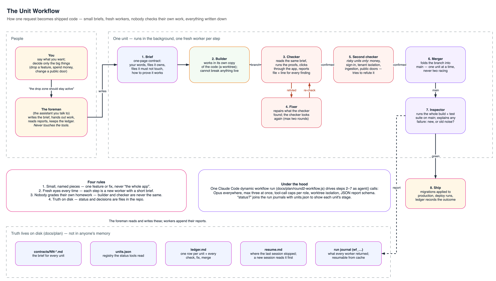
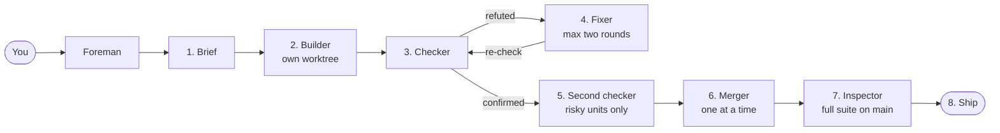

<div align="center">

# unit-workflow

### Build small. Check twice. Merge once.

unit-workflow is an open-source workflow for builders running Claude Code on codebases too big for one conversation. It helps you ship verified changes by breaking work into units that are built in isolation, checked by an agent that did not build them, fixed at most twice, and merged one at a time, with a live dashboard that shows every agent's log as it runs. MIT licensed.

[](LICENSE)
[](https://claude.com/claude-code)
[](skill/unit-workflow/SKILL.md#models-fable-orchestrates-opus-55-everywhere-else)
[](dashboard/)
[](examples/units.json)
[](#status)
[](https://github.com/nubbthedestroyer/unit-workflow/commits/main)


<sub>The live dashboard, playing a simulated build at 6× speed. Each card is one unit of work. It lights up as a builder, checker, fixer or merger takes it, and the arrows show which units are waiting on which. Everything ends in <code>main</code>.</sub>

**[Try the demo](#try-the-dashboard-in-30-seconds)** · **[Quick start](#quick-start)** · **[How it works](docs/how-it-works.md)** · **[The rules](docs/rules.md)**

</div>

<br>

Every piece of work becomes a **unit**: a one-page brief, a fresh agent in its own copy of the code, an independent checker, a merge, and a full test pass. Units run in the background, several at a time, while you keep talking to [Claude Code](https://claude.com/claude-code) about the next thing. No agent checks its own work, and every outcome is written to disk.

It was built while replacing a production SaaS platform end to end. In its first week it shipped **47 units** (features, fixes, migrations, an infrastructure cutover) with the founder reviewing outcomes, not diffs.

## See every agent, live

<table>
<tr>
<td width="50%" valign="top">

<br><b>Open any agent's log.</b><br><sub>Every command it runs, every file it reads or edits, and the output of each, as it happens. The report it hands back appears at the bottom.</sub>
</td>
<td width="50%" valign="top">

<br><b>The board.</b><br><sub>One column per stage, from Queued to Integration. A card sits in the column of whoever is working on it right now.</sub>
</td>
</tr>
<tr>
<td width="50%" valign="top">

<br><b>Checkers refute.</b><br><sub>This checker ran the acceptance tests, found two failures, and sent the unit back. The fixer receives exactly those two findings and nothing else.</sub>
</td>
<td width="50%" valign="top">

<br><b>One unit, in full.</b><br><sub>Its agents, models, tool calls, tokens and verdicts; the findings against it; and the units it is holding up.</sub>
</td>
</tr>
</table>

<p align="center"><br><sub>The flowchart lays itself out for whatever screen it is on. This is a portrait monitor next to the editor.</sub></p>

### Try the dashboard in 30 seconds

```bash
git clone https://github.com/nubbthedestroyer/unit-workflow
cd unit-workflow/dashboard && pnpm install && pnpm demo   # http://localhost:3041
```

That plays a simulated build on a loop. To watch your own units, run `pnpm dev` instead. The dashboard reads the files unit-workflow already writes, so there is nothing to connect. Details in [dashboard/README.md](dashboard/README.md).

---

## Why this exists

Ask one AI assistant to build a whole product in one long conversation and four things go wrong. It forgets what it was told at the start. It reads half the codebase to find one file. Two changes made at the same time step on each other. And you can no longer tell what is *done* from what it *said* it did.

unit-workflow is four rules, one for each problem:

| Rule | What it means in practice |
|---|---|
| **Small, named pieces** | A unit is one feature or one fix. Never "the whole app". |
| **Fresh eyes every time** | Each step is a brand-new worker reading a one-page brief, not the chat history. |
| **Nobody grades their own homework** | The worker that built it never checks it. Risky work gets a second checker whose only job is to find fault. |
| **Truth lives on disk** | Status, decisions and results are files in the repo. A new session picks up exactly where the last one stopped. |

---

## The life of a unit

You say what you want. The foreman (the assistant you talk to) turns it into a unit and starts it through the stages.





1. **Brief.** A one-page contract: your words at the top, the files the unit owns, the files it must not touch, where to copy patterns from, and the commands that prove it is done.
2. **Builder.** Works in its own git worktree, so it cannot break anything you or another unit is doing.
3. **Checker.** Reads the same brief, runs the proofs, clicks through the app, and reports a file and line for every finding.
4. **Fixer.** Repairs what the checker found. The checker looks again. At most two rounds.
5. **Second checker.** Only for risky units: money, sign-in, tenant isolation, data ingestion, anything reachable from outside. Its brief is to *refute*.
6. **Merger.** Folds the branch into `main`, one unit at a time.
7. **Inspector.** Runs the whole build and test suite on `main` and explains every failure: new, or old noise?
8. **Ship.** Migrations are applied, the deploy runs, and the ledger records the outcome.

Ask **"status?"** at any moment for a table of every unit, its stage, and how long it has been there. Or leave the [dashboard](dashboard/) open on a second monitor.

A plain-language walk-through, written for someone who has never used AI tooling, is in [docs/how-it-works.md](docs/how-it-works.md).

---

## What the foreman reads and writes

A contract. This is the entire brief a builder sees:

```markdown
# Contract: Miles chat pane grip and resize

## Purpose
The owner, 2026-09-10: "The AI chat pane needs a grip pill and the ability to resize it a little bit."

## Owns
- components/shell/chat-pane.tsx: a vertical grip pill on the inner edge; pointer-drag resize
  between 20rem and 40rem; keyboard arrows; double-click resets; width persisted in localStorage
  with the same hydration guard the file already uses.
- Do NOT edit: components/chat/*, components/try/*, lib/*.
- Tests: Vitest for the clamp/persist helpers; Playwright: drag, reload, width persists.

## Reference slice (copy from, do not explore further)
- components/shell/chat-pane.tsx:27-65 localStorage open flag; :160-200 width animation
- app/globals.css `--chat-pane-w`

## Acceptance test
pnpm typecheck; pnpm vitest run test/unit/shell* --reporter=dot; pnpm verify; Playwright as above.
```

The launch. One call to the saved workflow by name; the script does the rest in the background:

```js
Workflow({
  name: 'unit-workflow',
  args: { target: '/abs/path/to/repo', plan: '/abs/path/to/repo/docs/plan',
          suiteCmd: 'pnpm build, then pnpm test --reporter=dot (tail -60), then pnpm verify',
          units: [{ key: '79-chat-pane-resize', risky: false,
                    contract: '79-chat-pane-resize.md',
                    brief: 'Grip pill and drag/keyboard resize for the chat pane, persisted.' }] }
})
```

The status table, ten minutes later. The [dashboard](dashboard/) shows the same thing live:

```
RUNNING / QUEUED (1)
unit                  what                         stage                    calls elapsed run
79-chat-pane-resize   Miles chat pane grip/resize  verify1 (port=done)      14    9m      wf_db9122bf-366

LAST COMPLETED (3)
unit                  what                                 status  when              outcome
78-sandbox-v3         national-average card, revenue band  merged  2026-09-10T22:50  verified+merged
77-savings-estimate   savings range hero                   merged  2026-09-10T20:50  verified+merged; suite green
76-jobs-push-v2       respond-fast jobs, hourly fallback   merged  2026-09-10T18:20  verified+merged
```

A worker's report. Every report has the same fixed shape, so the foreman reads fields, not paragraphs:

```json
{ "status": "done",
  "findings": [{ "path": "lib/sandbox/savings.ts", "line": 588,
                 "note": "spend basis had no document-status filter; now review OR approved" }],
  "changed": ["lib/sandbox/savings.ts", "components/try/savings-hero.tsx"],
  "verified": [{ "cmd": "pnpm typecheck", "pass": true },
               { "cmd": "pnpm vitest run test/unit/sandbox* --reporter=dot", "pass": true }],
  "ledgerUpdated": true, "blockers": [] }
```

---

## Quick start

You need Claude Code with the Workflow tool (dynamic workflows), a git repository, and a test command you trust.

1. **Install the skill.** Copy `skill/unit-workflow` to `~/.claude/skills/unit-workflow` (for every project) or `.claude/skills/unit-workflow` inside the repo (for one). Claude Code picks it up when you say "unit", "status?", or "launch X as a unit".
2. **Save the workflow by name.** Link the template where the Workflow tool looks for saved workflows, so every project launches the same script:
   ```sh
   mkdir -p ~/.claude/workflows
   ln -s ~/.claude/skills/unit-workflow/templates/unit-workflow.js ~/.claude/workflows/unit-workflow.js
   ```
3. **Create the plan folder** in your repo. It holds state, never a copy of the script:
   ```
   docs/plan/
     units.json          {"units":[]}
     ledger.md           one row per unit
     resume.md           where the last session stopped
     contracts/          one file per unit
   ```
   Put your project settings in the "Project defaults" section of `SKILL.md`: `target` and `plan`, plus `project`, `planDocs`, `suiteCmd`, `trailer` and `maxOpus` if you want them. The foreman passes them as `args` on every launch.
4. **Write the first contract** from `skill/unit-workflow/templates/contract.md`, register it in `units.json`, and say "launch it".
5. **Ask "status?"** whenever you like. Say "resume" in a new session and the foreman reads `resume.md` first.

Everything the foreman does is spelled out in [skill/unit-workflow/SKILL.md](skill/unit-workflow/SKILL.md).

---

## What is in this repository

| Path | What it is |
|---|---|
| [docs/how-it-works.md](docs/how-it-works.md) | The explainer, big picture first, details later. Start here if you are new. |
| [docs/rules.md](docs/rules.md) | Every rule the workflow runs on, with the incident that produced it. |
| [docs/diagrams/](docs/diagrams/) | The diagram above as editable draw.io, PNG, and the Python script that draws it. |
| [dashboard/](dashboard/) | The live dashboard: a flowchart and a board of every unit, refreshed every 3 seconds from the files on disk. `pnpm demo` plays a simulated build. |
| [skill/unit-workflow/](skill/unit-workflow/) | The Claude Code skill: SKILL.md, the saved workflow script, the contract template, the status command. |
| [examples/contracts/](examples/contracts/) | Three real contracts from production units: a feature, a numbers-heavy estimate, an external integration. |
| [examples/units.json](examples/units.json) | A real slice of the registry, showing the lifecycle fields. |

---

## Under the hood

The engine is a Claude Code **dynamic workflow**: a short JavaScript script that starts agents and decides what happens next based on what they return.

- `agent()` starts one worker with a prompt, a model, a cap on tool calls, its own worktree, and a JSON schema its report must match.
- `pipeline()` takes each unit through build, check, fix, second check and merge on its own. A unit merges the moment it clears, behind a lock so only one merge runs at a time, while other units are still being checked.
- One integration pass runs after the last merge.
- The same script serves every project. Paths and commands arrive as launch `args`, and `args.only` reruns a subset of units by key.
- Every run has an id and a journal of what each agent returned. A stopped or edited run resumes from that journal instead of starting over.

**Models.** The foreman, which is your main session, runs on Claude Fable. Every worker the script starts is pinned to Claude Opus 5.5 (`claude-opus-5-5`), three at a time per run across all stages (`args.maxOpus` changes that). Each role has a tool-call cap: about 60 to build, 30 to fix, 20 to check, 15 to merge. Read-only lookups may use Sonnet.

**Cost.** A feature-sized unit spends 400k to 1.1M tokens across its six to ten workers. That is the price of isolation and independent checking. It is still cheaper than one long chat that rereads the codebase twice and ships something half-checked.

---

## What it is not

- Not a framework or a library. It is a skill file, a script template, and a way of working. There is nothing to import.
- Not an autonomous product manager. The foreman decides routine things on its own and stops for you on four kinds of decision: dropping a feature, changing a public URL or API, spending money, touching an external service.
- Not for tiny changes. A one-line fix goes to a single agent in a worktree, not a unit.

---

## Status

Public beta. The skill, script template and rules come from a production project where they run every day. The project-specific defaults live in one marked section of `SKILL.md` and reach the script as launch `args`, so adopting it is an edit, not a rewrite. Issues and questions are welcome.

## License

[MIT](LICENSE)
