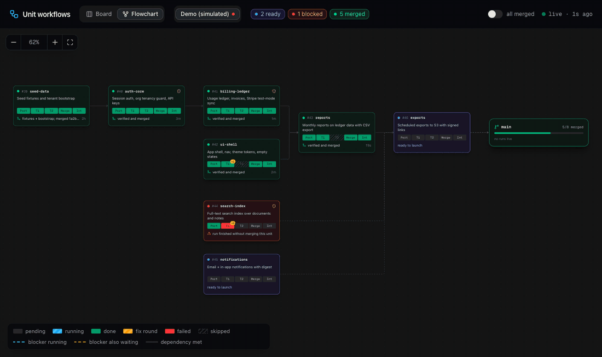
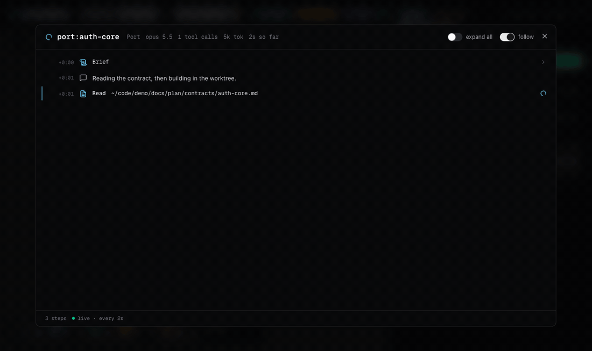
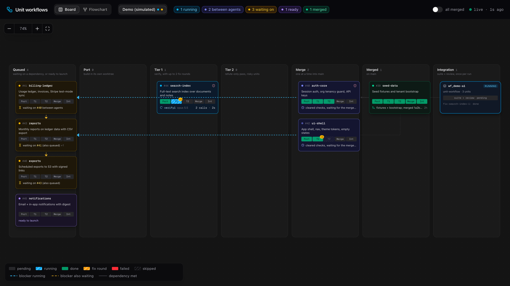
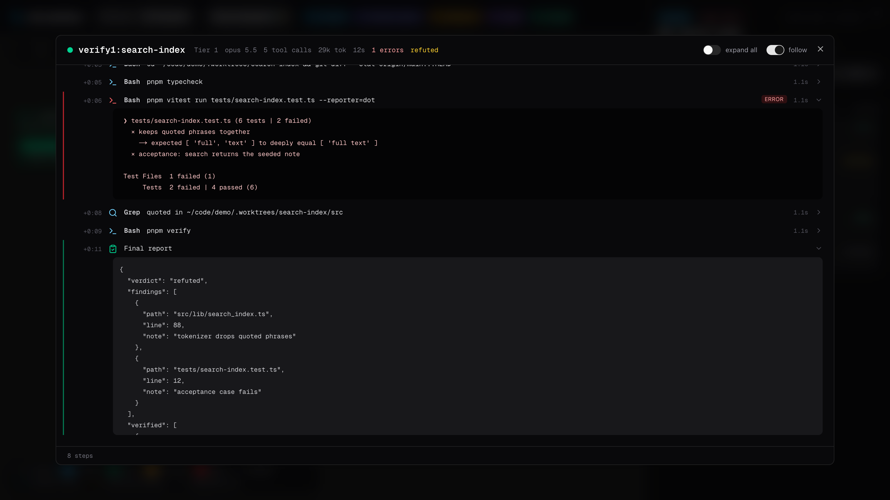
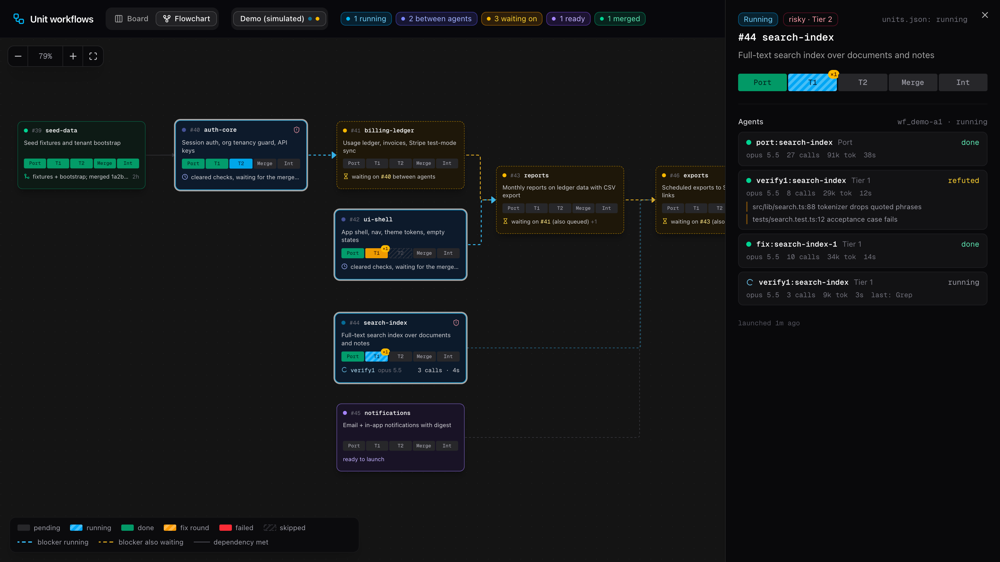
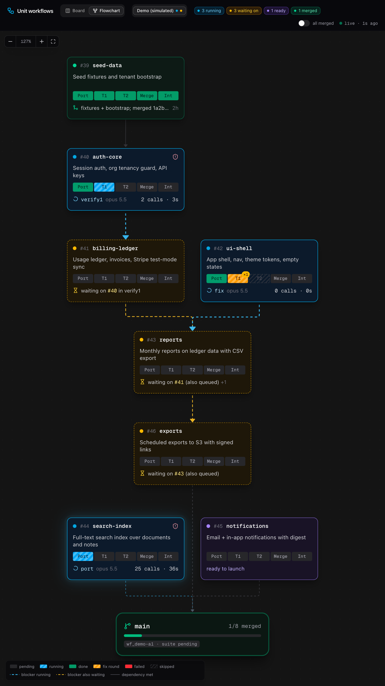
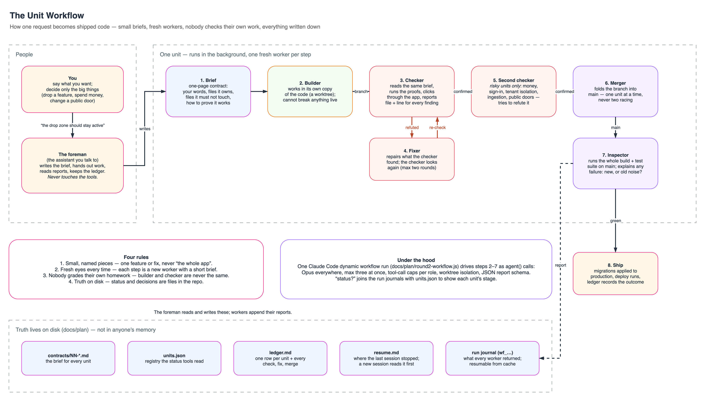
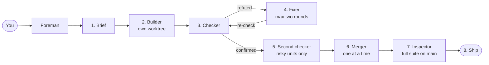

<div align="center">

# unit-workflow

### Build small. Check twice. Merge once.

unit-workflow is an open-source workflow for builders running Claude Code on codebases too big for one conversation. It helps you ship verified changes by breaking work into units that are built in isolation, checked by an agent that did not build them, fixed at most twice, and merged one at a time, with a live dashboard that shows every agent's log as it runs. MIT licensed.

[](LICENSE)
[](https://claude.com/claude-code)
[](skill/unit-workflow/SKILL.md#models-opus-thinks-and-writes-code-sonnet-runs-and-walks)
[](dashboard/)
[](docs/rules.md)
[](#status)
[](https://github.com/nubbthedestroyer/unit-workflow/commits/main)



<sub>The live dashboard, playing a simulated build at 6× speed. Each card is one unit of work. It lights up as a builder, checker, fixer or merger takes it, and the arrows show which units are waiting on which. Everything ends in <code>main</code>.</sub>

**[Try the demo](#try-the-dashboard-in-30-seconds)** · **[Quick start](#quick-start)** · **[Customize](#customize-it-for-your-project)** · **[How it works](docs/how-it-works.md)** · **[The rules](docs/rules.md)**

</div>

<br>

Every piece of work becomes a **unit**: a one-page brief, a fresh agent in its own copy of the code, an independent checker, a merge, and a full test pass. Units run in the background, several at a time, while you keep talking to [Claude Code](https://claude.com/claude-code) about the next thing. No agent checks its own work, and every outcome is written to disk.

It was built while replacing a production SaaS platform end to end. In its first week it shipped **47 units** (features, fixes, migrations, an infrastructure cutover) with the founder reviewing outcomes, not diffs.

## See every agent, live

<table>
<tr>
<td width="50%" valign="top">

<br><b>Open any agent's log.</b><br><sub>Every command it runs, every file it reads or edits, and the output of each, as it happens. The report it hands back appears at the bottom.</sub>
</td>
<td width="50%" valign="top">

<br><b>The board.</b><br><sub>One column per stage, from Queued to Integration. A card sits in the column of whoever is working on it right now.</sub>
</td>
</tr>
<tr>
<td width="50%" valign="top">

<br><b>Checkers refute.</b><br><sub>This checker ran the acceptance tests, found two failures, and sent the unit back. The fixer receives exactly those two findings and nothing else.</sub>
</td>
<td width="50%" valign="top">

<br><b>One unit, in full.</b><br><sub>Its agents, models, tool calls, tokens and verdicts; the findings against it; and the units it is holding up.</sub>
</td>
</tr>
</table>

<p align="center"><br><sub>The flowchart lays itself out for whatever screen it is on. This is a portrait monitor next to the editor.</sub></p>

### Try the dashboard in 30 seconds

```bash
git clone https://github.com/nubbthedestroyer/unit-workflow
cd unit-workflow/dashboard && pnpm install && pnpm demo   # http://localhost:3041
```

That plays a simulated build on a loop. To watch your own units, run `pnpm dev` instead. The dashboard reads the files unit-workflow already writes, so there is nothing to connect. Details in [dashboard/README.md](dashboard/README.md).

---

## Why this exists

Ask one AI assistant to build a whole product in one long conversation and four things go wrong. It forgets what it was told at the start. It reads half the codebase to find one file. Two changes made at the same time step on each other. And you can no longer tell what is *done* from what it *said* it did.

unit-workflow is four rules, one for each problem:

| Rule | What it means in practice |
|---|---|
| **Small, named pieces** | A unit is one feature or one fix. Never "the whole app". |
| **Fresh eyes every time** | Each step is a brand-new worker reading a one-page brief, not the chat history. |
| **Nobody grades their own homework** | The worker that built it never checks it. Risky work gets a second checker whose only job is to find fault. |
| **Truth lives on disk** | Status, decisions and results are files in the repo. A new session picks up exactly where the last one stopped. |

---

## The life of a unit

You say what you want. The foreman (the assistant you talk to) turns it into a unit and starts it through the stages.





1. **Brief.** A one-page contract: your words at the top, the files the unit owns, the files it must not touch, where to copy patterns from, and the commands that prove it is done.
2. **Builder.** Works in its own git worktree, so it cannot break anything you or another unit is doing.
3. **Checker.** Reads the same brief, runs the proofs, clicks through the app, and reports a file and line for every finding.
4. **Fixer.** Repairs what the checker found. The checker looks again. At most two rounds.
5. **Second checker.** Only for risky units: money, sign-in, tenant isolation, data ingestion, anything reachable from outside. Its brief is to *refute*.
6. **Merger.** Folds the branch into `main`, one unit at a time.
7. **Inspector.** Runs the whole build and test suite on `main` and explains every failure: new, or old noise?
8. **Ship.** Migrations are applied, the deploy runs, and the ledger records the outcome.

Ask **"status?"** at any moment for a table of every unit, its stage, and how long it has been there. Or leave the [dashboard](dashboard/) open on a second monitor.

A plain-language walk-through, written for someone who has never used AI tooling, is in [docs/how-it-works.md](docs/how-it-works.md).

---

## What the foreman reads and writes

A contract. This is the entire brief a builder sees:

```markdown
# Contract: chat pane grip and resize

## Purpose
The owner, 2026-09-10: "The AI chat pane needs a grip pill and the ability to resize it a little bit."

## Owns
- components/shell/chat-pane.tsx: a vertical grip pill on the inner edge; pointer-drag resize
  between 20rem and 40rem; keyboard arrows; double-click resets; width persisted in localStorage
  with the same hydration guard the file already uses.
- Do NOT edit: components/chat/*, components/try/*, lib/*.
- Tests: Vitest for the clamp/persist helpers.

## Reference slice (copy from, do not explore further)
- components/shell/chat-pane.tsx:27-65 localStorage open flag; :160-200 width animation
- app/globals.css `--chat-pane-w`

## Walk
- / at 1440x900: drag the grip, reload, the width persists; arrow keys resize; double-click resets.

## Acceptance test
pnpm typecheck; pnpm vitest run test/unit/shell* --reporter=dot; pnpm verify.
```

The launch. The foreman resolves your settings (`scripts/resolve.mjs`), adds the units, and makes one call to the saved workflow; the script does the rest in the background:

```js
Workflow({
  name: 'unit-workflow',
  args: { ...resolvedArgs,   // target, plan, commands, models, rules from your override layers
          units: [{ key: '79-chat-pane-resize', risky: false,
                    contract: '79-chat-pane-resize.md',
                    brief: 'Grip pill and drag/keyboard resize for the chat pane, persisted.',
                    walk: '/ at 1440x900: drag, reload, width persists' }] }
})
```

The status table, ten minutes later. The [dashboard](dashboard/) shows the same thing live:

```
RUNNING / QUEUED (1)
unit                  what                         stage                    calls elapsed run
79-chat-pane-resize   chat pane grip/resize        walk (verify1=verified)      14    9m      wf_db9122bf-366

LAST COMPLETED (3)
unit                  what                                 status  when              outcome
78-export-csv         export a filtered list as CSV            merged  2026-09-10T22:50  verified+merged
77-billing-webhooks   idempotent payment webhooks              merged  2026-09-10T20:50  verified+merged; suite green
76-job-retries        retry failed background jobs with backoff merged  2026-09-10T18:20  verified+merged
```

A worker's report. Every report has the same fixed shape, so the foreman reads fields, not paragraphs:

```json
{ "status": "done",
  "findings": [{ "path": "src/api/webhooks/billing.ts", "line": 41,
                 "note": "event id was recorded after the change; now in the same transaction" }],
  "changed": ["src/api/webhooks/billing.ts", "db/migrations/0042_processed_events.sql"],
  "verified": [{ "cmd": "pnpm typecheck", "pass": true },
               { "cmd": "pnpm vitest run src/api/webhooks --reporter=dot", "pass": true }],
  "ledgerUpdated": true, "blockers": [] }
```

---

## Quick start

You need Claude Code with the Workflow tool (dynamic workflows), a git repository, and a test command you trust.

1. **Install.** From a clone of this repo:
   ```sh
   node install.mjs                          # skill, saved workflow, lean agent types, your override folder
   node install.mjs --browser-mcp <name>     # if your Playwright MCP server is not named "playwright"
   node install.mjs --project /path/to/repo  # also scaffold the repo's .unit-workflow/ overrides
   ```
   Rerun it to update. It replaces the skill and never touches your overrides. Start a new Claude Code session afterwards so the agent types load.
2. **Create the plan folder** in your repo. It holds state, never a copy of the script:
   ```
   docs/plan/
     units.json          {"units":[]}
     ledger.md           one row per unit
     resume.md           where the last session stopped
     contracts/          one file per unit
   ```
3. **Set your project up** in `<repo>/.unit-workflow/`: commands, branch, models, rules (see [Customize](#customize-it-for-your-project)). Check the merged result with `node ~/.claude/skills/unit-workflow/scripts/resolve.mjs <repo>`.
4. **Write the first contract** from the template, register it in `units.json`, and say "launch it".
5. **Ask "status?"** whenever you like. Say "resume" in a new session and the foreman reads `resume.md` first.

Everything the foreman does is spelled out in [skill/unit-workflow/SKILL.md](skill/unit-workflow/SKILL.md).

---

## Customize it for your project

Nothing in the skill is specific to one app, company or toolchain. Your settings live in **override layers** outside it, so updates never overwrite them and you never hand-merge.

| Layer | Where | For |
|---|---|---|
| built-in | `skill/unit-workflow/defaults.json` | everyone (replaced on update) |
| you | `~/.claude/unit-workflow/config.json`, `overrides.md` | you, every project |
| you, one project | `~/.claude/unit-workflow/projects/<repo name>/` | you, one project, kept out of its repo |
| the project | `<repo>/.unit-workflow/` | the team (commit it) |
| one launch | `args` | one run |

Later layers win. Each layer can hold:

- **`config.json`**: any launch argument. That includes commands (`pm`, `typecheckCmd`, `suiteCmd`), git (`baseBranch`, `push`), models per role, concurrency, handoff budget, and agent types.
- **`overrides.md`**: plain-language rules, in three kinds of section.
  - `## Foreman` is read by your main session only: deploy steps, ports, when to stop.
  - `## All workers` is added to every agent's prompt.
  - `## Role: walk` (or `port`, `fix`, `verify1`, `verify2`, `merge`, `suite`, `review`) is added to that role only.
- **`contract.md`**: your own contract template.

`node ~/.claude/skills/unit-workflow/scripts/resolve.mjs <repo>` shows what was read and the merged launch args. The foreman runs it before every launch, so agents pick up your overrides without being told. The full key list is in [SKILL.md](skill/unit-workflow/SKILL.md#customize-the-override-layers). A worked example for a fictional app is in [examples/.unit-workflow/](examples/.unit-workflow/).

To give a project's workers different tools, put a `lean-worker.md` or `lean-checker.md` in `<repo>/.claude/agents/`. Project agent types take precedence over your user-level ones.

---

## What is in this repository

| Path | What it is |
|---|---|
| [docs/how-it-works.md](docs/how-it-works.md) | The explainer, big picture first, details later. Start here if you are new. |
| [docs/rules.md](docs/rules.md) | Every rule the workflow runs on, with the incident that produced it. |
| [docs/diagrams/](docs/diagrams/) | The diagram above as editable draw.io, PNG, and the Python script that draws it. |
| [dashboard/](dashboard/) | The live dashboard: a flowchart and a board of every unit, refreshed every 3 seconds from the files on disk. `pnpm demo` plays a simulated build. |
| [skill/unit-workflow/](skill/unit-workflow/) | The Claude Code skill: SKILL.md, the saved workflow script, `defaults.json`, the contract and override templates, the resolve and status commands. |
| [agents/](agents/) | The lean agent types every worker runs as. |
| [install.mjs](install.mjs) | Installs or updates everything; never touches your overrides. |
| [examples/](examples/) | A fictional app's contracts (a UI feature, a risky integration), a slice of its registry, and its `.unit-workflow/` overrides. |

---

## Under the hood

The engine is a Claude Code **dynamic workflow**: a short JavaScript script that starts agents and decides what happens next based on what they return.

- `agent()` starts one worker with a prompt, a model, a cap on tool calls, its own worktree, and a JSON schema its report must match.
- `pipeline()` takes each unit through build, check, fix, second check and merge on its own. A unit merges the moment it clears, behind a lock so only one merge runs at a time, while other units are still being checked.
- One integration pass runs after the last merge.
- The same script serves every project. Paths, commands, models and rules arrive as launch `args`, resolved from the override layers, and `args.only` reruns a subset of units by key.
- Every run has an id and a journal of what each agent returned. A stopped or edited run resumes from that journal instead of starting over.

**Models.** The foreman, your main session, writes the contracts. Claude Opus 5.5 builds, fixes and reviews risky diffs. Claude Sonnet 5.5 runs the checks, walks the screens, merges and runs the suite. Every worker uses a lean agent type (`agents/`) that skips connectors and skills. Builders hand off to a fresh agent after about 50 tool calls. Three Opus and six Sonnet agents run at a time. All of it can be changed per project in the override layers.

**Cost.** A feature-sized unit spends 400k to 1.1M tokens across its six to ten workers. That is the price of isolation and independent checking. It is still cheaper than one long chat that rereads the codebase twice and ships something half-checked.

---

## What it is not

- Not a framework or a library. It is a skill file, a script template, and a way of working. There is nothing to import.
- Not an autonomous product manager. The foreman decides routine things on its own and stops for you on four kinds of decision: dropping a feature, changing a public URL or API, spending money, touching an external service.
- Not for tiny changes. A one-line fix goes to a single agent in a worktree, not a unit.

---

## Status

Public beta. The skill, script template and rules come from a production project where they run every day. Everything project-specific lives in your override layers, so adopting it is a config file, not a fork. Issues and questions are welcome.

## License

[MIT](LICENSE)
