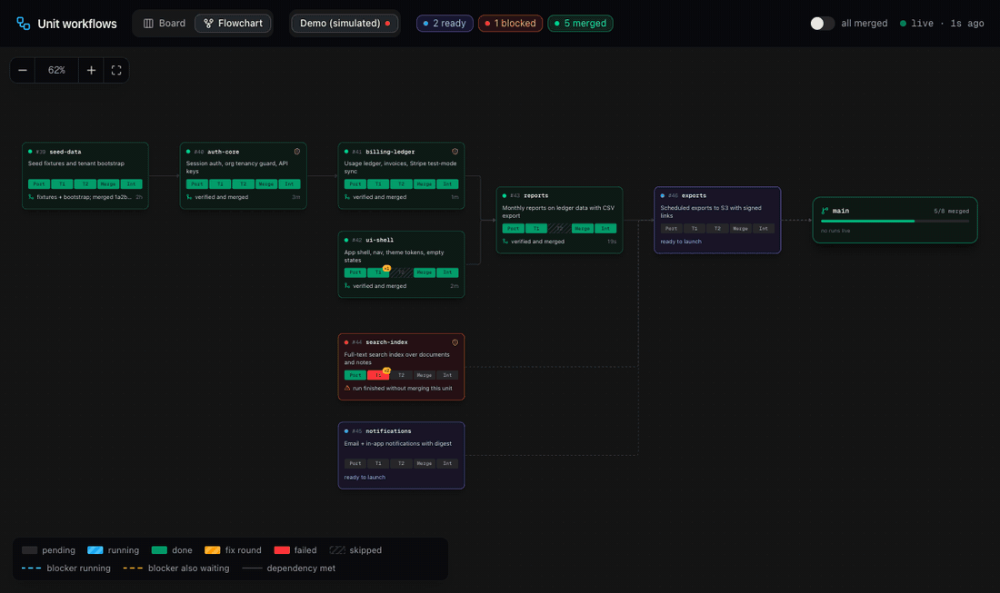
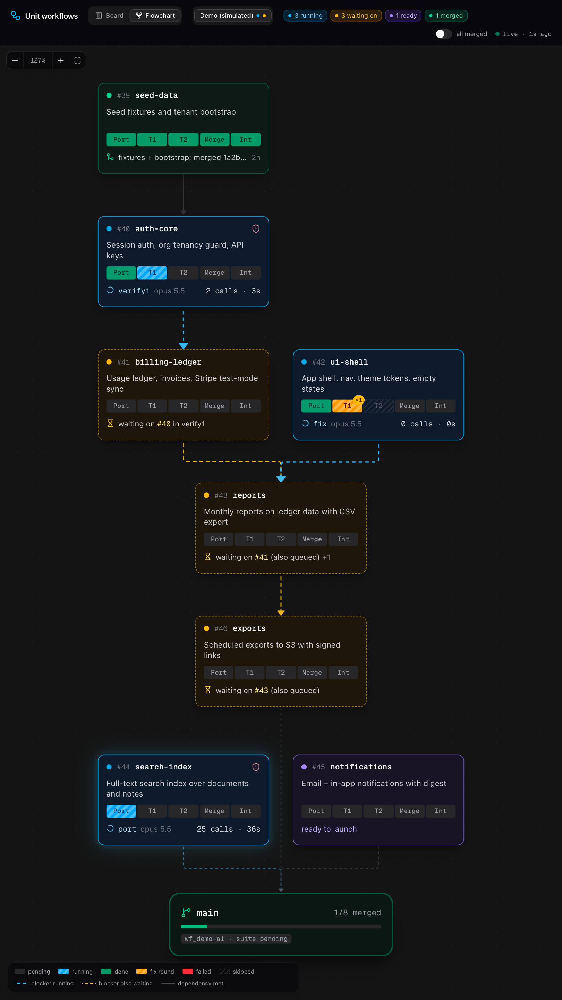
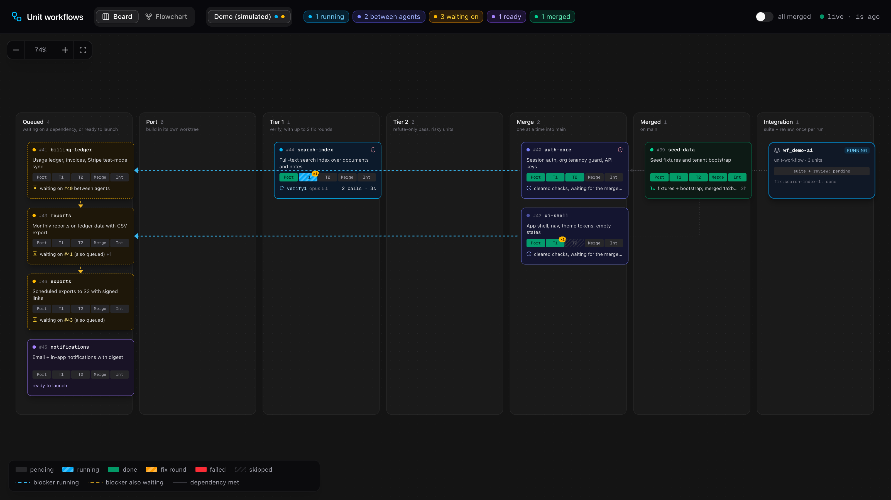
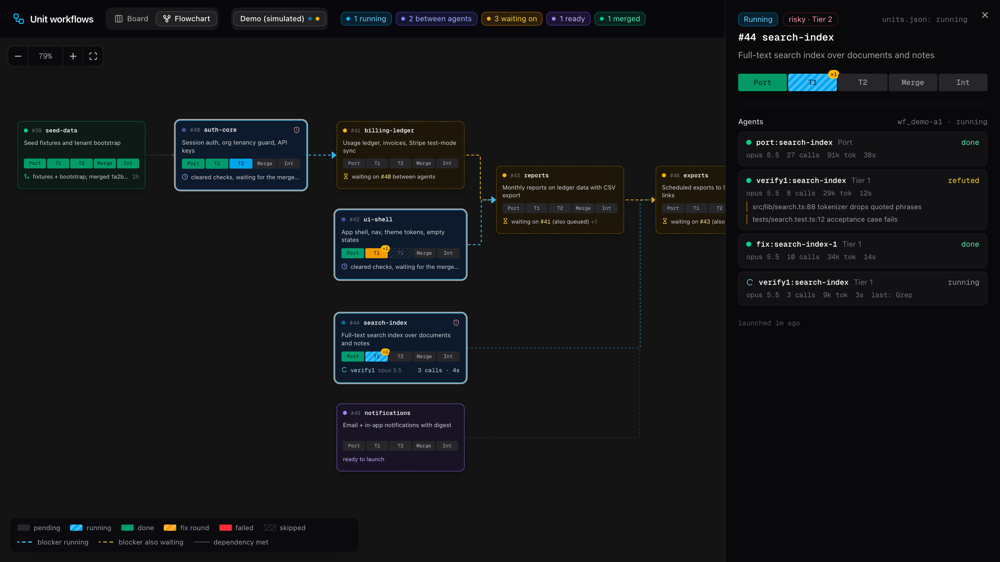

# unit-workflow dashboard

**Watch your AI crew work.** A live, local map of every unit: what is building, what is being checked, what is waiting on what, and what just merged.



It reads the files unit-workflow already writes (`units.json` and the Workflow tool's run journals), so there is nothing to wire up. It polls every 3 seconds and never writes anything.

## Try it in 30 seconds

No units of your own yet? The demo plays a simulated build on a loop.

```bash
cd dashboard
pnpm install
pnpm demo
```

Open http://localhost:3041.

To watch your real runs:

```bash
pnpm dev -p 3040
```

Open http://localhost:3040.

## Two views

**Flowchart.** The plan as a dependency tree that ends in `main`. The chart stays still and the cards change color as work moves through them. It turns to fit the window: top to bottom on a portrait monitor, left to right on a wide one, and zooms to fill the space.

<p align="center"></p>

**Board.** One column per tier: Queued, Port, Tier 1, Tier 2, Merge, Merged, Integration. Each card sits in the column of the agent working on it right now.



**Details.** Click any card for its agents, models, tool calls, tokens, the checker's findings, and what it blocks.



## Reading a card

- **The five-cell bar** is the unit's path: Port, T1, T2, Merge, Int. Blue stripes are running, green is done, amber stripes are a fix round (the badge counts rounds), red failed, hatched skipped (Tier 2 for a unit that is not risky).
- **Arrows** are `queuedBehind` dependencies. Blue and moving: the blocker is running. Amber dashed: the blocker is itself waiting. Grey: met.
- **Status** is one of running, between agents (waiting for an agent slot or the merge lock), waiting on, ready, merged, blocked, stale (the run was killed or went quiet), deferred.
- **A note** appears when `units.json` disagrees with what the run actually did, so a stale registry is easy to spot.

## Where it looks

- `units.json` in `~/Documents/repos/*/plan`, `~/Documents/repos/*/docs/plan`, `~/*/plan`, any `args.plan` from a past run, and any folder in `PLAN_DIRS`.
- Runs in `~/.claude/projects/*/*/workflows/wf_*.json` (written when a run ends) and `~/.claude/projects/*/*/subagents/workflows/wf_*/journal.jsonl` (live agent starts and results).

| Setting | Default | What it does |
|---|---|---|
| `PLAN_DIRS` | none | Extra plan folders, colon separated. |
| `LIVE_MINUTES` | 20 | A run with no activity for this long counts as stale. |
| `CLAUDE_PROJECTS_DIR` | `~/.claude/projects` | Where Claude Code keeps session files. |
| `UNIT_DASHBOARD_DEMO` | on | Set to `0` to hide the simulated Demo project. |
| `UNIT_DASHBOARD_DEMO_ONLY` | off | Set to `1` to show only the demo (what `pnpm demo` does). |
| `UNIT_DASHBOARD_DEMO_SPEED` | 1 | Play the demo loop faster, for recordings. |

## Built with

Next.js, React Flow, dagre, shadcn/ui and Tailwind. Local only, no auth, no database. It is meant to sit on a second monitor while you keep talking to the foreman.
